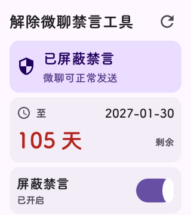
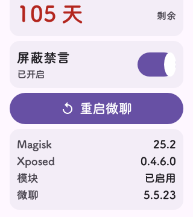

# XTC MuteGuard · 解除微聊禁言工具

小天才（XTC）手表微聊的**禁言屏蔽** Xposed 模块，附带禁言状态查询与一键重启微聊。

> 适用设备：小天才 Z9（`Z9_SN` / `msm8937_32go_nd01`），Android 8.1（API 27），armeabi-v7a
> 微聊版本：`com.xtc.weichat` 5.5.23（versionCode 55230）

<p align="center">
  
  
</p>

---

## 功能

| 功能 | 说明 |
|---|---|
| **禁言屏蔽** | Hook 微聊的禁言判定方法，使其恒返回「未禁言」，解除输入框禁用与发送拦截 |
| **状态查询** | 读取微聊本地库的违规记录，展示处罚结束日期与剩余天数 |
| **一键开关** | 开启/关闭屏蔽，模块未启用时开关自动禁用并置灰 |
| **一键重启微聊** | 改完开关后无需手动操作，点一下即可让配置生效 |
| **环境信息** | 展示 Magisk 版本、Xposed 版本、模块启用状态、微聊版本 |

界面按 [Material 3](https://m3.material.io) 规范实现：baseline 浅色色板（primary `#6750A4`）、五级 Type Scale、8dp 卡片圆角、surface container 层级表达高度、Material Symbols 图标。

---

## 工作原理

微聊的禁言判定链路：

```
服务端云控下发违规记录
  └─> 客户端写入 SQLite: db_illegal_record
       └─> IllegalRecordManger.d()          ← 判定「是否禁言」
            └─> IllegalMessageHandler        ← 发送前检查
                 └─> UI 禁用输入框 / 拦截发送
```

本模块 Hook 三个 Java 层方法，统一返回 `false`：

| 类 | 方法 |
|---|---|
| `com.xtc.data.safety.illegal.record.IllegalRecordManger` | `boolean d()` |
| 同上 | `boolean e()` |
| `com.xtc.data.safety.illegal.handler.IllegalMessageHandler` | `boolean a(DbChatConversation)` |

**关键发现**：底层 `MsgService.getMsgBinder().sendTextMsg()` 本身**不校验禁言**。禁言只拦在 UI 与业务入口，因此把 Java 层判定改为 `false` 后，输入与发送链路同时恢复。

> ⚠️ `IllegalRecordManger.c()` 与 `IllegalMessageHandler.b(Context, ChatMsg)` 是 **native 方法**，Xposed 无法 Hook，且主动调用会导致微聊崩溃，请勿触碰。

### 它不能做什么

**无法解除服务端的真实处罚**。禁言状态由服务端下发，客户端只是缓存——直接改本地数据库会被服务端覆盖（已实测）。本模块只屏蔽客户端判定，服务端记录仍然存在，到期自动解除。

---

## 构建

本项目**不使用 gradle**，直接用 `aapt2 + javac + d8 + apksigner` 构建，依赖极轻。

### 依赖

- JDK 17
- Android SDK Build-Tools 34（提供 `aapt2` / `d8` / `zipalign` / `apksigner`）
- Android Platform 27 的 `android.jar`
- Python 3（仅用于把 dex 合并进 APK）

### 步骤

```bash
export JAVA_HOME=/path/to/jdk-17
export ANDROID_BUILD_TOOLS=/path/to/build-tools/34.0.0
export ANDROID_JAR_PATH=/path/to/platforms/android-27/android.jar
export PYTHON=python3

bash build.sh
# 产物：MuteGuard.apk
```

首次构建会自动生成 `keystore.jks`（口令 `muteguard2026`），后续复用。**该密钥仅用于调试，请勿用于正式发布**。

### 两个必须知道的坑

**1. `xposedminversion` 不能写 82**

EdXposed v0.4.6 的框架 API 版本低于 82。写 `82` 会导致模块被**静默跳过**，无任何报错日志。本模块写 `54`。

**2. Xposed API 桩不能进 dex**

`stub/de/robv/android/xposed/*` 只用于编译期。若被打包进 `classes.dex`，模块类解析到的接口是桩类而非框架类，`IXposedHookLoadPackage.class.isAssignableFrom()` 返回 false，模块同样被跳过。

`build.sh` 已处理：桩单独编译到 `build/stub-classes`，仅作为 `javac` 的 `-classpath` 与 `d8` 的 `--lib`，不进入 dex 输入。

---

## 安装

1. 设备需已 root（Magisk）并安装 **EdXposed**
2. 安装 APK：
   ```bash
   adb install -r MuteGuard.apk
   ```
3. 在 EdXposed Manager 中勾选本模块
4. **重启设备**（EdXposed 在 zygote 启动时读取模块列表）
5. 打开「解除微聊禁言工具」，确认状态卡显示「已屏蔽禁言」

### 手工启用（无法打开 Manager 时）

```bash
# 1. 包名加入启用列表
echo com.xzd.yunkong >> /data/user_de/0/com.solohsu.android.edxp.manager/conf/enabled_modules.list

# 2. APK 路径加入模块列表
echo /data/app/com.xzd.yunkong-<hash>/base.apk >> \
     /data/user_de/0/com.solohsu.android.edxp.manager/conf/modules.list

# 3. 修正权限
chown u0_a44:root /data/user_de/0/com.solohsu.android.edxp.manager/conf/*.list
chmod 664 /data/user_de/0/com.solohsu.android.edxp.manager/conf/*.list
```

**注意**：每次重装 APK，`/data/app/` 下的 hash 目录会变，必须同步更新 `modules.list`，否则模块失效。

---

## 兼容性

| 项目 | 值 |
|---|---|
| 设备 | 小天才 Z9（其他型号未测试） |
| Android | 8.1 / API 27 |
| 架构 | armeabi-v7a（32 位，无 so 库） |
| Root | Magisk 25.2 |
| 框架 | EdXposed v0.4.6.0_beta(4476) YAHFA |
| 微聊 | 5.5.23 |

其他微聊版本可能因类名/方法签名变化而失效，日志中会输出 `hook xxx failed`。

---

## 已知限制

1. 开关改动需**重启微聊**才生效（Hook 在 `handleLoadPackage` 阶段读取配置，不支持热更新）
2. 无法解除服务端处罚，只能屏蔽客户端判定
3. 重装 APK 后必须更新 EdXposed 的 `modules.list` 路径
4. 屏幕为 160×180 dp，内容分两屏，需滚动查看环境信息

---

## 免责声明

- 本项目**仅供学习与研究**，用于理解 Android 应用的风控实现与 Xposed Hook 机制。
- 仅可用于**你自己拥有并已 root 的设备**。
- 修改客户端行为可能违反厂商的用户协议，可能导致账号被进一步处罚（包括但不限于延长禁言、封号）。
- 作者不对因使用本项目造成的任何直接或间接损失负责，包括设备损坏、数据丢失、账号处罚。
- 请勿将本项目用于商业用途或任何违法场景。

---

## License

[GNU General Public License v3.0](LICENSE)

选择 GPL-3.0 而非 MIT 的原因：这类工具容易被包装成付费服务，GPL 要求衍生作品同样开源，能保证改进回流到社区。
